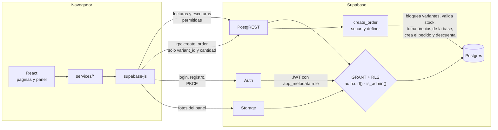
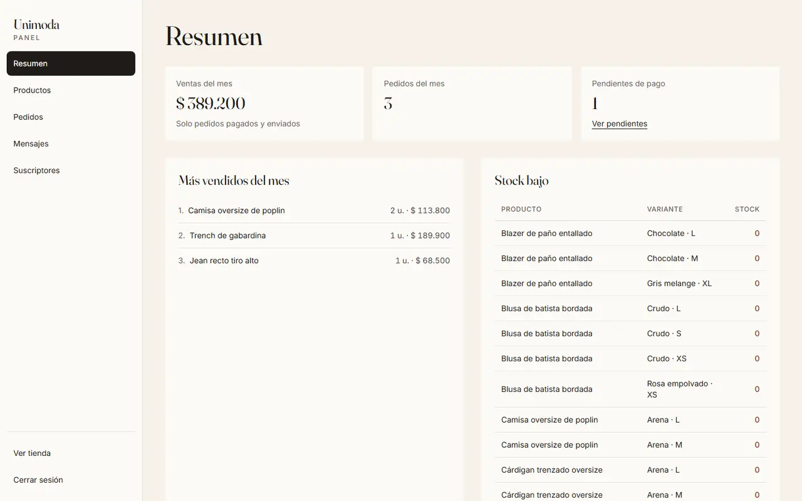
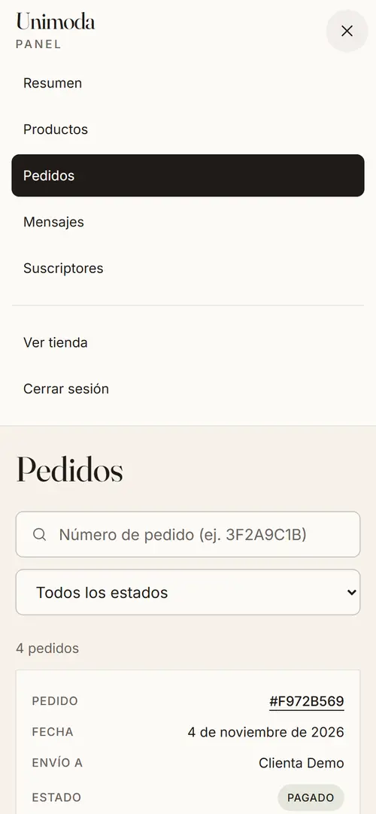

# Unimoda

E-commerce de moda femenina argentina: catálogo con filtros, carrito, cuentas, checkout con stock y precios validados en el servidor, y un panel de administración. Es un proyecto de portfolio: **el pago está simulado y no se cobra nada**.

**Demo:** <https://juantrezza.github.io/Unimoda/>

<p>
  
  
</p>

## Stack

| Capa | Tecnología |
| --- | --- |
| Front | React 19, TypeScript, Vite, Tailwind CSS 3, React Router (`HashRouter`), Zustand |
| Back | Supabase: Postgres con RLS, PostgREST, Auth (PKCE) y Storage. Sin servidor propio |
| Tests | Playwright en 375 y 1440 px, con Supabase mockeado |
| Deploy | GitHub Actions a GitHub Pages |

## Arquitectura

No hay backend propio: el navegador habla directo con Supabase usando la publishable key, que es pública por diseño. La seguridad vive en la base.



## Decisiones técnicas

**El precio se calcula en el servidor.** Lo que manda el navegador se puede modificar desde las DevTools. Por eso `create_order` recibe solo `[{variant_id, quantity}]` y una dirección: el precio sale de `products.price_cents`, el envío de `private.checkout_rules()` y el total se suma en la base. Los montos del front son informativos.

**RLS y `GRANT` explícitos.** El proyecto no expone tablas automáticamente: cada tabla tiene sus `GRANT` y sus políticas. Cada usuario ve y edita solo su perfil y sus direcciones, y puede *leer* sus pedidos. Solo un admin escribe el catálogo. Nadie puede escribir `orders` u `order_items` directamente, salvo el `status` que cambia un admin.

**Funciones `security definer`.** `create_order` y `cancel_order` corren con los permisos de su dueño, por eso pueden crear pedidos y descontar stock aunque el cliente no pueda. A cambio:

- usan `set search_path = ''` y nombres calificados, para que nadie pueda colar una tabla o función con el mismo nombre en otro schema;
- validan todo adentro: sesión, que la dirección o el pedido sean del usuario, 1 a 20 líneas, cantidad de 1 a 10, sin repetidos, producto activo y stock;
- bloquean las variantes con `SELECT … FOR UPDATE` ordenado por id, sin sobreventa ni deadlocks, y hacen todo en una transacción;
- limitan a 5 pedidos pendientes por usuario por hora;
- tienen `EXECUTE` solo para `authenticated`.

**El rol va en `app_metadata`.** `user_metadata` lo puede editar el propio usuario con `supabase.auth.updateUser()`: si el rol estuviera ahí, cualquiera podría hacerse admin. `app_metadata` solo se escribe con `service_role` o desde SQL. Supabase lo copia al JWT, así que RLS lo lee sin consultar tablas (`private.is_admin()`). El chequeo del front es solo para la interfaz.

**PKCE con `HashRouter`.** GitHub Pages no reescribe rutas, por eso las URLs son `/Unimoda/#/tienda`. Con PKCE, Supabase agrega `?code=…` a la URL de vuelta. Si esa URL tuviera un `#/ruta`, el código quedaría detrás del hash y el router lo tomaría como parte de la ruta. Por eso los links de los emails vuelven a la raíz con un tipo (`/Unimoda/?auth=recovery`). Antes de montar React se espera a que auth-js canjee el código y se reemplaza la URL por la ruta con hash, sin dejar el `code` en el historial (`src/lib/authRedirect.ts`). Si el link se abre en otro navegador no está el *code verifier*: el email igual queda confirmado y se manda a Ingresar con un aviso.

**Otras decisiones**

- El carrito guarda solo SKU y cantidad; precio, nombre y stock se leen siempre del catálogo.
- Los filtros viven en la URL, así el link se puede compartir, y se resuelven en la consulta, no en memoria.
- Precios en centavos (enteros) en la base.
- Las transiciones de estado de un pedido y la devolución de stock están en un trigger: valen para cualquier camino.

## Rendimiento

Lighthouse mobile con `npm run preview`, mediana de 3 corridas por página (`npm run lighthouse`). Mide contra un mock local de Supabase, no contra la base real.

| Página | Performance | Accessibility | Best Practices | SEO |
| --- | --- | --- | --- | --- |
| Inicio | 76 | 100 | 100 | 100 |
| Tienda | 77 | 100 | 100 | 100 |
| Producto | 86 | 100 | 100 | 100 |

Performance no llega a 90. Lo que limita es el JS de una SPA sin prerender (110 kB gzip antes del primer render) y las fuentes (hasta 193 kB). Además, Lighthouse simula la red a partir de una carga local, y el resultado varía unos 5 puntos entre corridas.

Lo que ya está hecho: versiones WebP de 360 y 640 px con `srcset` y `sizes` (`npm run images`), carga diferida por ruta, supabase-js fuera del arranque, app shell estático en `index.html`, `preload` de fuentes y `preconnect` a Supabase.

## SEO y sus límites con `HashRouter`

Cada página tiene su título y descripción. El detalle de producto agrega Open Graph con su foto y JSON-LD de `Product` con precio y disponibilidad. El panel, la cuenta y el checkout van con `noindex`.

`HashRouter` es lo que permite publicar en GitHub Pages sin un servidor que reescriba rutas, pero tiene un costo:

- **Sin sitemap.** Lo que va después del `#` no se envía al servidor y los buscadores lo descartan: para ellos todo el sitio es una sola URL. Un sitemap con `/#/producto/…` no serviría, por eso no hay.
- **Los previews no ven cada producto.** Las etiquetas por producto se escriben con JavaScript. WhatsApp, Facebook y otros no lo ejecutan: al compartir un link muestran el título y la imagen generales del `index.html`.
- **`robots.txt` no tiene efecto en un sitio de proyecto.** Los buscadores solo leen el de la raíz del dominio, y este queda en `/Unimoda/robots.txt`.

La salida es un dominio propio con `BrowserRouter` y prerender de las páginas de producto. Ahí el sitemap, los previews y `robots.txt` pasarían a funcionar.

## Cómo correrlo localmente

Necesitás Node 20 o más nuevo y un proyecto de Supabase con las [migraciones](#migraciones) aplicadas.

```bash
git clone https://github.com/JuanTrezza/Unimoda.git
cd Unimoda
npm install
cp .env.example .env.local   # completalo con la URL y la publishable key del proyecto
npm run dev                  # http://localhost:5173/Unimoda/
```

Para el login, configurá en Supabase, en Authentication → URL Configuration, la Site URL y agregá `http://localhost:5173/Unimoda/**` a las Redirect URLs.

| Script | Qué hace |
| --- | --- |
| `npm run dev` | Desarrollo |
| `npm run build` / `npm run preview` | Build de producción y servirlo |
| `npm run test:e2e` | Tests end-to-end |
| `npm run lighthouse` | Mide Inicio, Tienda y Producto contra el mock |
| `npm run mock:api` | Mock de Supabase como servidor local |
| `npm run images` | Genera las versiones WebP de las fotos |
| `npm run db:seed` | Regenera `supabase/seed.sql` desde `src/data/products.ts` |
| `npm run docs:screenshots` | Regenera las capturas y el video de `docs/screenshots/` |

### Estructura

```
src/
  admin/         panel de administración (chunk aparte)
  components/    layout, ui, product, cart, shop, account, auth
  pages/         tienda, cuenta y checkout
  services/      catálogo, formularios, cuenta y pedidos: la única puerta a Supabase
  store/         carrito, favoritos, sesión y toasts (Zustand)
  hooks/, lib/, data/
supabase/        migraciones SQL y seed.sql (generado)
scripts/         seed, imágenes, Lighthouse, mock como servidor y capturas
tests/           Playwright y supabase-mock.ts
docs/            capturas y lista de fotos
```

## Migraciones

En el SQL Editor de Supabase, pegá y corré cada archivo completo, en este orden:

1. `supabase/migrations/0001_catalog.sql`: catálogo, índices y búsqueda
2. `supabase/migrations/0002_forms.sql`: newsletter y contacto
3. `supabase/migrations/0003_rls_and_grants.sql`: permisos y políticas RLS
4. `supabase/migrations/0004_auth_orders.sql`: perfiles, direcciones, pedidos, `create_order` y `cancel_order`
5. `supabase/migrations/0005_admin.sql`: rol admin, políticas del panel, bucket de fotos y funciones del panel
6. `supabase/seed.sql`: categorías, productos, colores, imágenes y variantes

Son idempotentes. El seed hace upsert por `slug` / `sku` y al final muestra un conteo de control.

> Si volvés a correr una migración anterior (0001, 0003 o 0004 revocan permisos), volvé a correr también las siguientes, en orden.

Para cambiar el catálogo inicial: editá `src/data/products.ts`, corré `npm run db:seed` y volvé a correr `seed.sql`. Después del primer deploy, lo normal es usar el panel.

### Deploy

`.github/workflows/deploy.yml` compila y publica `dist/` en cada push a `master`. Hace falta elegir **GitHub Actions** en Settings → Pages → Source y crear los secrets `VITE_SUPABASE_URL` y `VITE_SUPABASE_PUBLISHABLE_KEY`. La publishable key termina en el bundle público, eso es esperado: la seguridad la dan RLS y los `GRANT`.

## Tests

```bash
npx playwright install chromium   # la primera vez
npm run test:e2e
```

Corren en 375 y 1440 px con un build aparte (`dist-e2e`) y `page.route`: **no usan la red ni la base real**. `tests/supabase-mock.ts` emula PostgREST, Auth y Storage con las mismas reglas que las migraciones, y parte de los mismos datos que el seed.

Cubren el recorrido de compra, filtros en la consulta, registro y login, callbacks de email, rutas protegidas, checkout, errores de stock, cancelación, el panel completo, SEO, errores y reintentos.

El mock no reemplaza a Postgres: las políticas RLS y las funciones SQL en sí no se ejecutan en estos tests.

## Panel de administración

<p>
  
  
</p>

- **Resumen**, calculado en la base: ventas y pedidos del mes (solo pagados y enviados), pendientes, los 5 más vendidos y las variantes con stock ≤ 2.
- **Productos**: alta y edición, colores, grilla de stock color × talle y fotos por color. Las fotos se achican a 1600 px de alto y se convierten a WebP en el navegador antes de subirlas a Storage.
- **Pedidos**: filtro por estado, búsqueda por número y cambio de estado (`pendiente_pago → pagado → enviado`, o `cancelado`, que devuelve el stock).
- **Mensajes** y **Suscriptores**: listas paginadas y exportación a CSV.

Sin el rol de admin, `/admin` muestra la página 404, como si no existiera, y el código del panel ni se descarga.

### Cómo ver el panel

El panel no es público y este repo no incluye credenciales. Para verlo podés:

- mirar el [video del recorrido](docs/screenshots/panel-demo.webm) y las capturas de [`docs/screenshots/`](docs/screenshots/), generados con datos de prueba;
- pedirme acceso por [GitHub](https://github.com/JuanTrezza).

### Crear un admin en tu propio proyecto

1. Creá la cuenta desde el sitio y confirmá el email.
2. En el SQL Editor:

   ```sql
   update auth.users
   set raw_app_meta_data = coalesce(raw_app_meta_data, '{}'::jsonb) || '{"role": "admin"}'::jsonb
   where email = 'tu-email@ejemplo.com';
   ```

3. Cerrá sesión y volvé a entrar: el rol viaja dentro del JWT y el token anterior no lo tiene.

## Roadmap

- **Mercado Pago**: Checkout Pro desde una Edge Function, con un webhook que valide la firma y sea el único camino a `pagado`.
- **Emails transaccionales**: confirmación de pedido, aviso de envío y respuesta a contacto.
- **Dominio propio con `BrowserRouter` y prerender**, para resolver los límites de SEO y mejorar el rendimiento.
